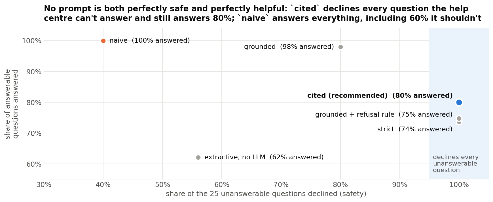
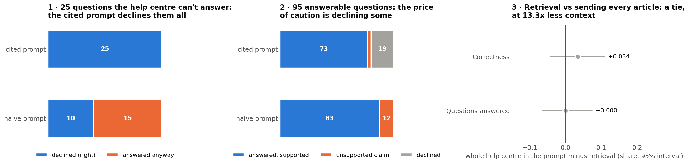

# StreamFlix RAG: Is a Support Assistant Safe to Deploy?

[](https://github.com/janeruxi1/StreamFlix-RAG-evaluation/actions/workflows/ci.yml)

[](https://janeruxi1-streamflix-rag-evaluation.streamlit.app/)

**[Decision memo](reports/decision_memo.md)** · **[Live demo](https://janeruxi1-streamflix-rag-evaluation.streamlit.app/)** · **[Notebooks](notebooks/README.md)** · **[Routing note](reports/routing_note.md)**

A retrieval-augmented assistant answers customer questions from a streaming service's 45 help-centre
articles. The deliverable is not the assistant but the evidence: *is it safe to put in front of customers,
and how would we know?* 120 questions with hand-labelled sources, 25 of them deliberately unanswerable,
were written before any retrieval code. Generator `gpt-4o-mini`, judge `gpt-4o`; CI checks every number below.

## Key results

- **Pilot the `cited` prompt with a support agent in the loop; never ship the `naive` one.**
  `cited` refused **25 of 25** unanswerable questions; `naive` declined **10 of 25** and answered the rest,
  14 of them with unsupported claims. Twenty-five questions bound `cited`'s true refusal rate only at **86.7%** or better.
- **It rarely makes things up.** **0** fabricated citations; **3 of 76** answers had an unsupported claim
  (faithfulness 0.984). The price of caution: it declined **19 of 95** answerable questions, and `naive` is
  +0.160 [+0.102, +0.219] more correct on those.
- **Retrieval is optional at this size.** Sending all 45 articles instead ties on every measure
  (correctness +0.034 [-0.041, +0.109]) at 13.3x the context; retrieval stays for cost and growth.
- **Route tickets with a fine-tuned small model, not a general LLM.** On 3,080 real banking tickets, a
  BGE-small fine-tune routes 97% automatically while keeping 95% of those correct; gpt-4o-mini reaches 66.6%.



*Each prompt's share of unanswerable questions declined (safety) against its share of answerable questions
answered (helpfulness). Only prompts in the shaded band decline every unanswerable question; `cited`
answers the most of those. Drawn from the recorded results by `scripts/make_readme_figure.py`.*

## How it works

| Step | Method | Where |
|---|---|---|
| Test first | Golden set and source labels written before the system; unanswerable questions by design | [01](notebooks/01_corpus_construction.ipynb) |
| Retrieval | 64 configurations of chunking and retriever compared with paired tests and a multiple-comparison correction; BM25 over sections, 0.882 context recall for about 571 tokens; a transformer retriever +0.025 [-0.039, +0.090], inconclusive | [02](notebooks/02_chunking_embedding.ipynb) · [03](notebooks/03_retrieval_bakeoff.ipynb) |
| Generation | `naive` vs `cited` prompts; refusal, faithfulness, correctness | [04](notebooks/04_generation.ipynb) |
| Judge the judge | LLM judge validated on cases with known verdicts before any score is used (**100% on 9 cases**; a lexical judge 50%); length and leniency bias checked | [05](notebooks/05_evaluation.ipynb) · [06](notebooks/06_judge_analysis.ipynb) |
| Is retrieval needed? | A pre-registered test against all 45 articles in the prompt | [08](notebooks/08_full_corpus_baseline.ipynb) |
| What the evidence is worth | Cost of a wrong answer; the bad-answer rate moves the system's value 5.8x as much as the refusal rate, so the [pilot](reports/pilot_design.md) is sized on it | [09](notebooks/09_decision_model.ipynb) |
| Route the ticket | TF-IDF, frozen and fine-tuned BGE-small (PyTorch), zero-shot LLM; calibration and a 95%-correct auto-route bar | [11](notebooks/11_ticket_routing.ipynb) |

| Router (Banking77, 77 intents) | Test accuracy | Auto-routed at the 95% bar | Calibration (ECE) |
|---|---|---|---|
| TF-IDF + logistic regression | 91.4% | 89.5% | 0.097 |
| BGE-small, frozen | 93.0% | 97.4%, but only 94.4% correct | 0.106 |
| **BGE-small, fine-tuned** | **93.8%** | **97.0% at 95.3% correct** | **0.016** |
| gpt-4o-mini, zero-shot | 66.6% | no confidence to threshold | — |



*Left and middle: what each prompt did with the 120 test questions. Right: sending every article instead
of retrieving, with 95% paired-bootstrap intervals.*

## How the evidence is kept honest

- **The test and the judge come first.** If the judge fails its validation cases, the run stops.
- **A tie that undercuts the work is reported first.** The retrieval-or-not rule was
  [committed](https://github.com/janeruxi1/StreamFlix-RAG-evaluation/commit/e9bbef6) before the run.
- **Errors are corrected in the open.** A refusal check that missed nine `naive` declines is now scored
  against 88 hand-labelled answers; the memo says what changed.
- **Small samples are stated as bounds**, and reruns replay cached model responses byte for byte.

## Limits

- The help centre is synthetic, and one person wrote it and the questions; nothing here is real customer traffic.
- One generator, one judge, one run; no human labelled the answers the judge scored.
- Over-refusal is diagnosed, not fixed; two articles state different refund windows and no prompt surfaced it.

<details>
<summary><b>Run it</b> (no API key needed)</summary>

```bash
pip install numpy pandas scikit-learn matplotlib pytest
python -c "from src.corpus.build import write_corpus, write_golden_set; write_corpus(); write_golden_set()"
pytest tests/ -q                           # 548 tests (8 need streamlit, 8 need torch)
python notebooks/07_decision_memo.py       # checks the memo against the records
pip install -r app/requirements.txt && streamlit run app/streamlit_app.py   # the demo, replaying the run
python scripts/run_llm_eval.py --dry-run   # re-measuring with a model: plan and cost (about $6)
```

[`SETUP.md`](SETUP.md) covers the API key and a spend cap; `requirements-lock.txt` pins the exact versions.
Retraining the routers needs CPU torch (`scripts/run_routing.py`, about 4.5 hours on a laptop).

</details>

<details>
<summary><b>Repository layout and further reading</b></summary>

```
src/         corpus, retrieval, llm (provider, cache, keys), generation, evaluation, routing
notebooks/   01-11, each a .py source of truth with a generated .ipynb
reports/     memo, pilot design, routing note, measured records, run logs, figures
scripts/     the credentialed runs, notebook build, repository checks
app/         Streamlit demo
tests/       548 tests
```

[Pilot design](reports/pilot_design.md) · [Scenario brief](reports/scenario_brief.md) ·
[Phase notes](reports/phase_notes.md) · [Project summary](reports/PROJECT_SUMMARY.md)

</details>

**Related:** [A/B testing on real experiments](https://github.com/janeruxi1/ab-testing-real-experiments) ·
[Churn and retention](https://github.com/janeruxi1/churn-uplift-decisioning) ·
[All projects](https://github.com/janeruxi1)
